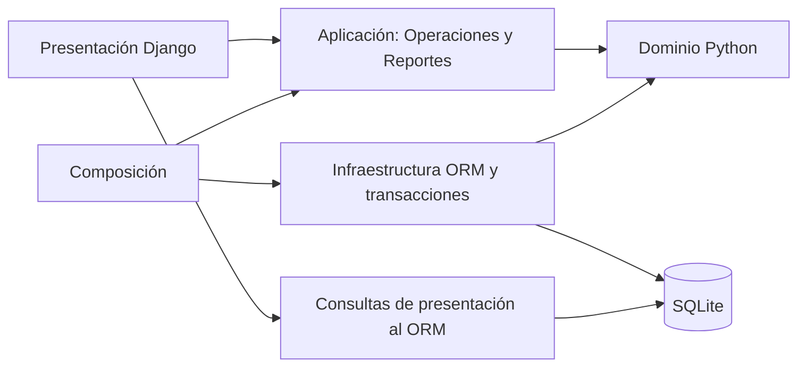

# Arquitectura implementada

## Dependencias y responsabilidades

`dominio` no importa Django. Contiene la jerarquía Ubicacion / CentroDistribucion / LocalMinorista, catálogo, venta y renglón de venta, inventario, importes, consolidación, reglas de devolución y transiciones. Las entidades de dominio usadas por los procesos se construyen mediante mapeadores; los registros ORM no se confunden con sus equivalentes puros.

`aplicacion` coordina permisos, secuencias, transacciones y cálculos. `Operaciones` recibe adaptadores de datos, inventario, unidad de trabajo y reloj. `Reportes` recibe el adaptador de lectura y el control de acceso. `config/composicion.py` conecta las implementaciones.

`infraestructura` implementa el DAO de agregados (`DatosORM`), el repositorio de inventario, los mapeadores y la unidad de trabajo. `persistencia` contiene los modelos y migraciones. El dominio no conoce estas clases.

`presentacion` tiene rutas, formularios, vistas, plantillas y archivos estáticos. Las mutaciones del negocio se delegan a `Operaciones`; las altas y modificaciones de catálogos pasan por ModelForms y transacciones. Las consultas para listados usan el ORM directamente como adaptador de lectura.

## Límite deliberado de esta primera implementación

No se duplican todas las tablas como dataclasses ni se crean paquetes vacíos. Los agregados Compra, Orden, Remito, Bulto, Caja y Devolucion se recuperan mediante el DAO y exponen sus relaciones al orquestador. Ese contrato de acceso usa operaciones compatibles con el ORM, aunque aplicación no lo importe. Cambiar de motor SQL manteniendo Django no cambia los casos de uso; sustituir Django ORM por almacenamiento en archivos exigiría implementar también ese contrato de relaciones y consultas. No se afirma que un cambio completo de persistencia sea automático.

La herencia conceptual de ubicaciones se mantiene en dominio. En SQL se representa con una sola tabla y un discriminador CD/LOCAL; una restricción condicional permite como máximo un CD. Cada local creado desde la aplicación recibe una caja y un ítem por producto. No se crean tablas separadas para catálogos cerrados de medios, roles o tipos de comprobante: se representan con opciones enumeradas.

## Integridad y transacciones

- Las operaciones críticas ejecutan una unidad de trabajo con rollback ante cualquier excepción.
- SQLite usa `transaction_mode=IMMEDIATE` y timeout de 20 segundos. No se usa `select_for_update` como garantía porque no bloquea filas en SQLite.
- Las validaciones de saldo y disponible ocurren dentro de la misma transacción que escribe el resultado.
- Las restricciones SQL protegen unicidad, reservas, cantidades y referencias excluyentes de eventos, mermas y movimientos.
- Las transiciones se validan en dominio. El estado vigente se obtiene del último evento ordenado por fecha e identificador.
- Los eventos y registros financieros rechazan guardar actualizaciones y eliminaciones mediante sus modelos y QuerySets públicos. No hay interfaces de edición de operaciones registradas. La protección no pretende impedir modificaciones realizadas por alguien con acceso directo y arbitrario al archivo SQLite.
- Venta, devolución y movimiento manual usan un UUID único. Un reintento del mismo usuario devuelve el resultado registrado en lugar de repetir efectos.
- Los comprobantes son obligatorios y se crean dentro de la transacción de venta o devolución.

## Seguridad de acceso

Sesiones Django, contraseñas con hash, cierre de sesión por POST y protección CSRF. Se valida el rol y el local tanto al seleccionar los registros de las pantallas como en los casos de uso. Las ventas siempre se realizan en la caja del local del vendedor. La cuenta ADMIN_CD no se interpreta como vendedor de cualquier local.

Los formularios de usuarios exigen correspondencia entre rol y tipo de ubicación. Las bajas conservan las relaciones y bloquean operar desde usuarios o ubicaciones inactivas. La interfaz no permite modificar manualmente existencias ni reservas.

## Puntos para patrones docentes

| Punto | Implementación actual | Cambio cuando se conozca el patrón |
| --- | --- | --- |
| Ciclo de estados | Tabla pura y función de validación | Aplicar el patrón asignado preservando los contratos de transición |
| Reportes | Clase de consulta y cálculo por tipo | Separar estrategias o plantilla si corresponde a la asignación |
| Datos | DAO y repositorio con composición | Mantener o adaptar según exigencias docentes |
| Comprobantes | Construcción dentro de casos de uso | Introducir creación especializada si se asigna un patrón creacional |

No se eligieron dos patrones por cuenta propia ni se declara cumplido el requisito hasta recibir la asignación.
