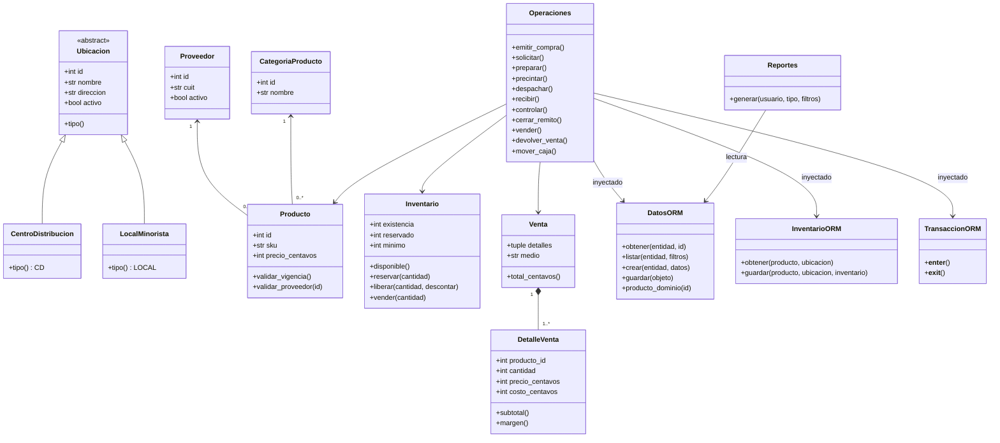

# Clases y responsabilidades

El siguiente diagrama distingue entidades puras, coordinación y adaptadores. El DER contiene todos los agregados persistentes y sus atributos. No se presenta una tabla SQL como si fuera una implementación pura del dominio.

Los nombres Venta, Producto y DetalleVenta existen también en persistencia: son modelos distintos, ubicados en otro módulo. Los mapeadores convierten los datos del catálogo a entidades puras; al vender se construye la Venta de dominio para validar renglones y calcular el total exacto, y después se persiste el resultado en una transacción.

Los catálogos cerrados de rol, medio de pago, tipo de movimiento y tipo de comprobante se implementan mediante opciones enumeradas; no necesitan altas de usuario ni clases vacías por valor.
