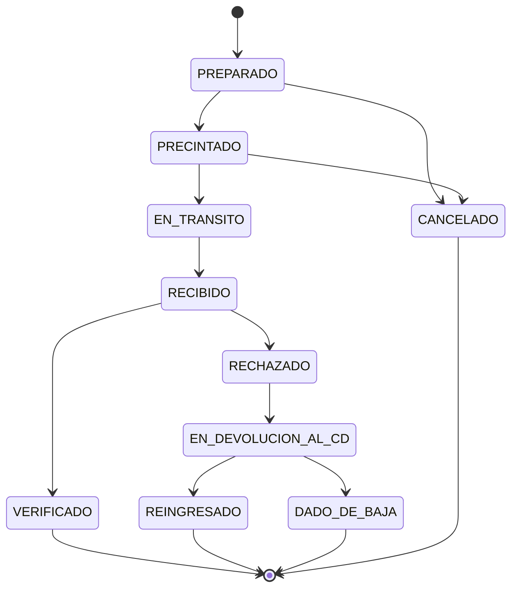
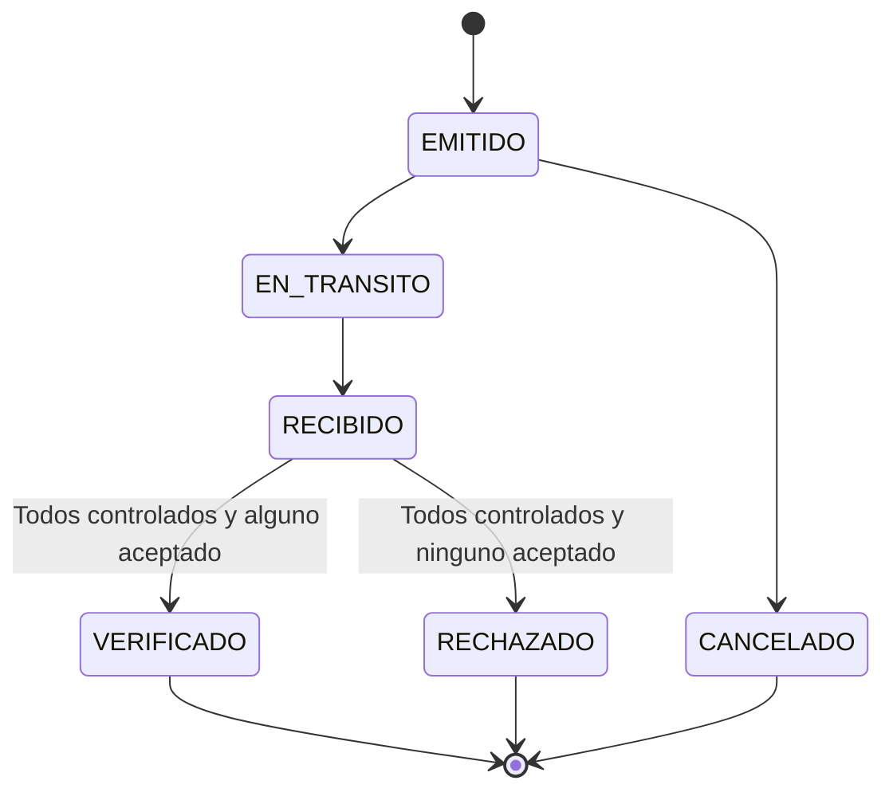
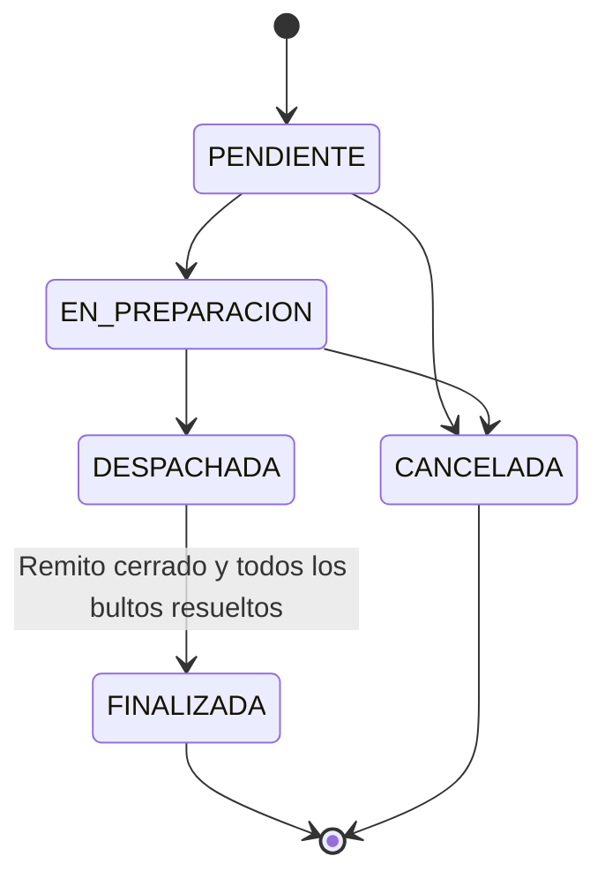
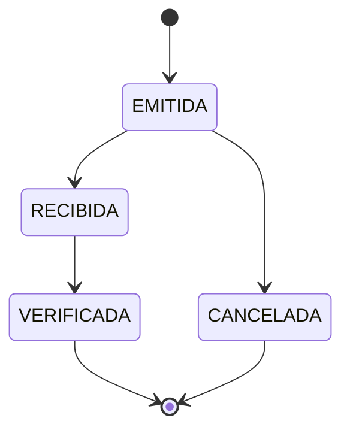

# Ciclos de vida

## Bulto

VERIFICADO expresa el resultado del control individual. **No habilita venta hasta que el remito cierre VERIFICADO**. Esta distinción es deliberada y evita la inconsistencia del borrador. El reingreso y la baja exigen una revisión registrada en el CD.

## Remito

## Orden de reposición

## Compra

Venta y Devolucion se registran en un paso y son inmutables. Las correcciones comerciales se expresan como devoluciones vinculadas a la venta, sin editar la operación original.

## Implementación del comportamiento

Bulto y Remito implementan estos ciclos mediante State en `src/dominio/estados.py`: los contextos reconstruyen su estado desde el último evento, delegan las acciones y cambian de objeto de estado al aceptar una transición. Las clases concretas rechazan acciones inválidas antes de registrar el resultado. Compras y órdenes siguen usando una tabla de transiciones.

El control individual decide aceptación o rechazo; un precinto violado fuerza rechazo aun si se solicita aceptar. El cierre solo se admite en RemitoRecibido y exige una colección no vacía de bultos controlados. Los estados finales no admiten nuevas acciones. El retorno exige remito cerrado y la resolución exige una observación de revisión. Los movimientos de inventario permanecen en la misma transacción que los eventos.
