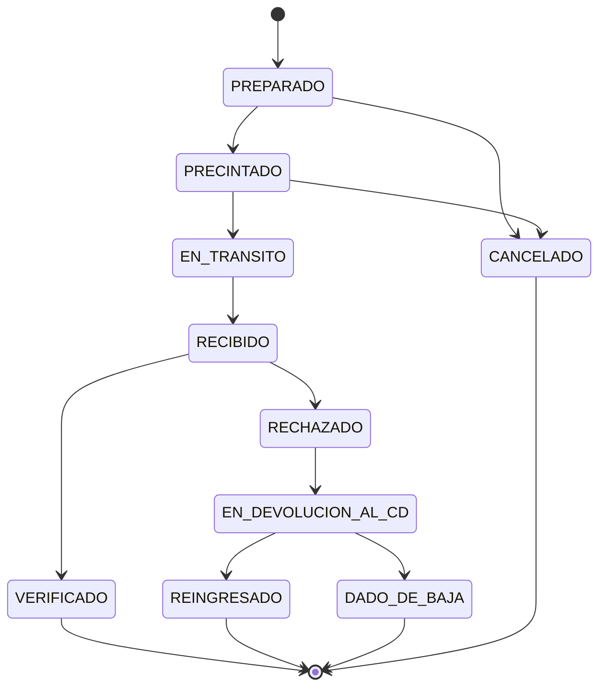
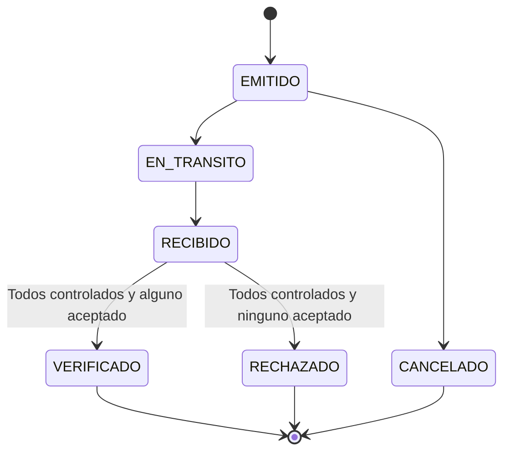
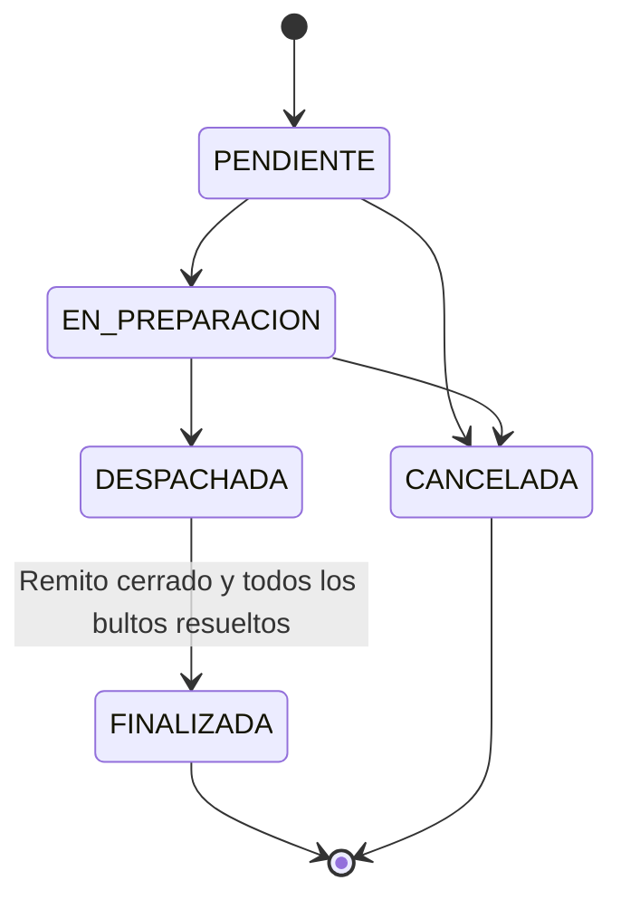
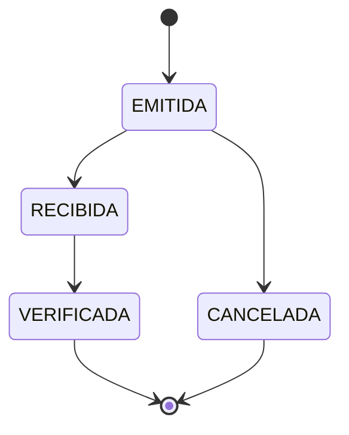

# Ciclos de vida

## Bulto

VERIFICADO expresa el resultado del control individual. **No habilita venta hasta que el remito cierre VERIFICADO**. Esta distinción es deliberada y evita la inconsistencia del borrador. El reingreso y la baja exigen una revisión registrada en el CD.

## Remito

## Orden de reposición

## Compra

Venta y Devolucion se registran en un paso y son inmutables. Las correcciones comerciales se expresan como devoluciones vinculadas a la venta, sin editar la operación original.
